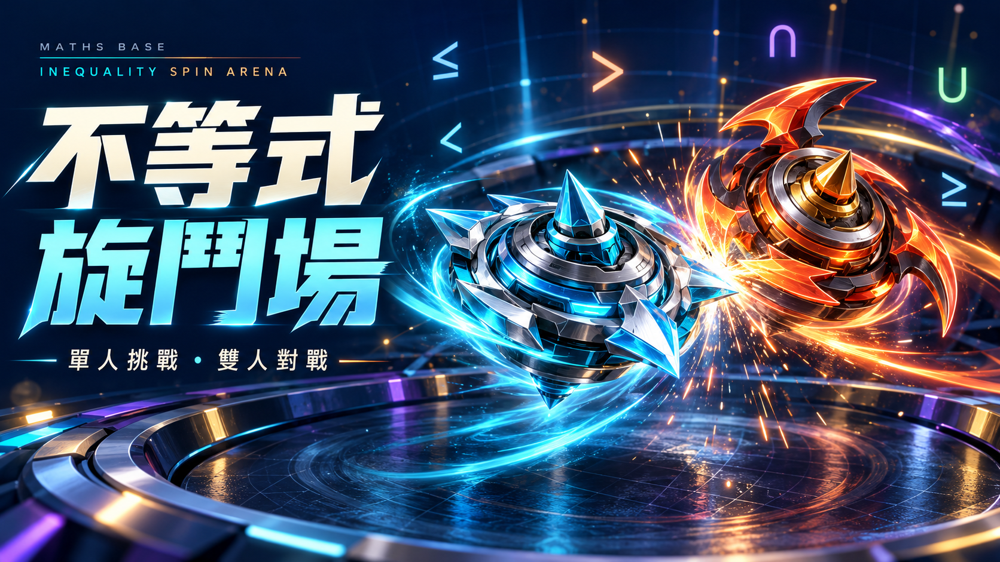

# 不等式旋鬥場 v1.1



[封面圖片直連（供數自學基地使用）](https://mr-kwchan.github.io/inequality-spin-arena/cover.png)

以複合一元一次不等式為陀螺補血、取得護盾及儲存必殺技能量的 Three.js 3D 教育遊戲。單人可在家挑戰 NPC，亦可兩人共用一部橫向 iPad 對戰。

**[立即遊玩](https://mr-kwchan.github.io/inequality-spin-arena/)** · 毋須登入

## v1.1 新功能（18-Oct-26）

- **單人 NPC 對戰**：練習伙伴、旋鬥對手、高手挑戰三個難度。NPC 自動準備、答題及發動必殺技；暫停後只需玩家確認繼續。
- **三款提示，每人每局各一次**：50/50 排除兩個錯誤選項；解題提示提供思考方法；加時 5 秒只延長自己的時限。提示後答對仍有完整補血、護盾及能量；該題不比較速度加成。
- **六款彩色陀螺**：霆光、霜衡、燼鋒、紫電、森盾、金穹。每款均可選左旋或右旋；NPC 的陀螺及旋向也可設定。

| 類型 | 陀螺／顏色 | 基本攻擊 | 每次承傷修正 | 每秒耗旋 |
| --- | --- | --- | --- | --- |
| 平衡型 | 霆光／青、霜衡／藍 | 3 | 標準 | 2 |
| 攻擊型 | 燼鋒／橙紅、紫電／紫 | 4 | +1 | 2.5 |
| 防禦型 | 森盾／綠、金穹／金 | 2 | −1 | 1.8 |

同旋：每次碰撞傷害 +1。對旋：較慢一方每碰撞從對手借力最多 1 旋轉值，不產生額外旋轉值。這是遊戲規則，並非真實物理模擬。護盾、低旋轉減傷及正解加成仍會影響實際傷害。

## 玩法

1. 橫向開啟，選「單人挑戰 NPC」或「雙人同機對戰」。
2. 選陀螺及旋向，按「準備發射」。單人只需左方準備；雙人各自準備。
3. 每段戰鬥 10 秒，之後回答四選一題目。選好後須按「鎖定答案」。
4. 卡住時可使用提示；雙方完成作答或各自時限到才揭曉。
5. 答對補血、恢復旋轉、取得護盾及能量。累積答對三題，可於戰鬥發動必殺技。
6. 最後一題後仍有一段戰鬥；賽後可逐題重溫及重練。

| 玩家 | 選項 A–D | 鎖定答案 | 必殺技 |
| --- | --- | --- | --- |
| P1 左方／單人玩家 | Q W E R | F | G |
| P2 右方（雙人模式） | U I O P | J | K |

教師設定可調整難度、4／6／8 題、10／15／20 秒、音量及特效。預設 6 題、7 段戰鬥。需要 WebGL 2；iPad 建議使用 Safari。

## 原始碼與本機遊玩

[下載完整 TypeScript 原始碼及驗收紀錄](source.zip)。`index.html` 已內嵌 Three.js、公式字體和合成音效，可在支援 WebGL 2 的桌面瀏覽器直接開啟。

解壓 source.zip 後：

```sh
npm ci
npm run check
npm run build:pages
npm test
```

`src/questions.json` 是題庫，`src/settings.ts` 是共用規則，`src/tops.ts` 設定陀螺、NPC 難度及提示。`npm run build:pages` 更新根目錄 index.html；本儲存庫以 main 分支根目錄發佈。

測試涵蓋核心、數學、DOM 模擬、NPC、提示、攻守與旋向及 Three.js 場景資料。完整結果見 source.zip 的 docs/test-output.txt。實際 iPad 多點觸控、WebGL 畫面及效能尚待驗證。答題紀錄只留在本場記憶體，教師設定保留於裝置。

Third-party licenses 見 THIRD_PARTY_LICENSES.txt；詳細說明及驗收紀錄在 source.zip 的 docs 資料夾。
