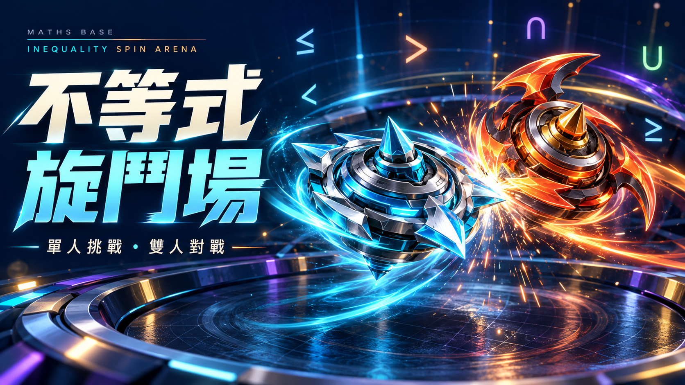

# 不等式旋鬥場 v1.2

用不等式答案為 3D 陀螺補血、取得護盾及儲存必殺技能量。單人可挑戰 NPC，亦可兩人共用一部橫向裝置對戰。

**[立即遊玩](https://mr-kwchan.github.io/inequality-spin-arena/)** · 毋須登入



[封面圖片直連（供 Maths Base 使用）](https://mr-kwchan.github.io/inequality-spin-arena/cover.png)

## v1.2 教學與操作更新 · 2026-11-25

- **答得好更容易贏**：答對回復 20 HP，普通碰撞基本攻擊降至 1–2。預設完成所有題目，以答對題數優先判勝，再比較 HP 和正確作答平均時間。
- **人人做齊題目**：教師可選「完成所有題目」。預設開啟，HP 歸零仍可繼續學習及補血；亦可關閉，採 HP 歸零即完場的競技模式。
- **讀完再繼續**：預設手動繼續解說，可改為 6／8／12 秒。答錯即顯示錯誤類型，正誤有各自橫額，解說與輔助字體加大。
- **題目更豐富**：36 條固定題，加 780 條程式生成變式；新增數線、區間記法、負數反號、及／或和整數應用題。支援「全進階」，跨場減少重複並兼顧題型多樣性。
- **作答更穩定**：避免每幀重建選項，修正滑鼠 click／Pointer Events 重複或漏接及 NPC 公式直排。每題有針對性提示。
- **課堂跟進**：結果頁可下載 UTF-8 CSV，包含每題答案、正誤、用時、提示及錯誤類型。預設每題 15 秒，進階題自動加 5 秒（可關閉）。
- **減少首次載入負擔**：網頁入口約 3.5 KB，遊戲、樣式與 WOFF2 公式字體分開快取；保留單檔離線版。

## 玩法

1. 選「單人挑戰 NPC」或「雙人同機對戰」，再選陀螺與旋向。NPC 有三個難度。
2. 按「準備發射」。每段戰鬥 10 秒，其後回答同一道四選一題；選項次序各自打亂。
3. 選好後按「鎖定答案」。每位真人玩家每局各有一次 50/50、解題提示及個人加時 5 秒。
4. 答對回復 20 HP、20 旋轉值，取得護盾及 1 格能量。提示後仍有完整獎勵；該題不比較速度加成。
5. 累積 3 格能量，在戰鬥中發動必殺技。答錯不會清空已儲能量。
6. 揭曉後閱讀解說，再按「我已讀完，繼續」。最後一題後仍有一段戰鬥。
7. 結果頁可逐題重溫、無時限重練及下載 CSV；重練不改動本場成績。

| 玩家 | 選項 A–D | 鎖定答案 | 必殺技 |
| --- | --- | --- | --- |
| P1 左方／單人玩家 | Q W E R | F | G |
| P2 右方（雙人模式） | U I O P | J | K |

教師設定有混合／全基礎／全標準／全進階、4／6／8 題、10／15／20 秒、進階加時、解說時間及完成所有題目。預設混合、6 題、15 秒、進階加 5 秒、手動繼續、完成全部題目。Escape 或右上角可暫停。

## 陀螺

六款陀螺均可左旋或右旋。

| 類型 | 陀螺／顏色 | 基本攻擊 | 每次承傷修正 | 每秒耗旋 |
| --- | --- | --- | --- | --- |
| 平衡型 | 霆光／青、霜衡／藍 | 1 | 標準 | 2 |
| 攻擊型 | 燼鋒／橙紅、紫電／紫 | 2 | +1 | 2.5 |
| 防禦型 | 森盾／綠、金穹／金 | 1 | −1 | 1.8 |

同旋每次碰撞傷害 +1；對旋時較慢一方每碰撞借力最多 1 旋轉值。護盾、低旋轉及正解加成也影響傷害。這是遊戲規則，並非真實物理模擬。

## 原始碼與本機遊玩

[下載完整 TypeScript 原始碼與驗收紀錄](source.zip)。解壓後，可直接開啟 `dist/PLAY.html`（自包含離線版，瀏覽器須支援 WebGL 2）。iPad 建議以 Safari 開啟已發佈網址。

開發及檢查：

```sh
npm ci
npm run check
npm run build
npm test
```

`npm run build` 產生 `dist/` 網站與 `dist/PLAY.html`。`npm run build:pages` 另產生可發佈到 GitHub Pages 的 `pages/` 平面目錄。此公開儲存庫以 main 分支根目錄發佈，完整可編輯專案在 source.zip。

`src/questions.json` 為固定題，`src/generator.ts` 產生變式，`src/diagrams.ts` 繪製數線，`src/settings.ts` 與 `src/tops.ts` 集中遊戲規則。詳見 source.zip 中的 `docs/DEVELOPMENT.md`、`docs/V1.2-CHANGES.md`、`docs/ACCEPTANCE.md`。

驗證涵蓋核心規則、816 題數學／TeX、滑鼠與鍵盤事件、NPC、提示、CSV、完整賽局及 Three.js 場景資料。另以獨立介面測試頁，在真實瀏覽器檢查滑鼠提交、正誤揭曉、NPC 公式及字體；該測試頁使用 3D 替身，未作為遊戲發佈。實體 iPad、多點觸控和實際 WebGL 效能尚待實測。

本場答案只留在記憶體；離開前請匯出 CSV。教師設定及最近題號保存在本機，不上傳學生答案。Third-party licenses 見 THIRD_PARTY_LICENSES.txt。
